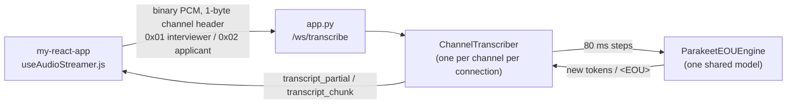

# NVIDIA Parakeet Realtime EOU 120M in `asr-service`

**Service:** `[asr-service]` · **Model:** [`nvidia/parakeet_realtime_eou_120m-v1`](https://huggingface.co/nvidia/parakeet_realtime_eou_120m-v1)

## 1. Model summary

| Property | Value |
| :--- | :--- |
| Parameters | ~120M |
| Architecture | Cache-aware streaming FastConformer (17 layers) + RNNT decoder |
| Attention context | `[70, 1]`: 70 frames left, 1 frame (80 ms) look-ahead |
| Input | 16 kHz mono PCM, processed in **80 ms chunks** |
| Output | Lower-case English text, no punctuation, plus an `<EOU>` token at end of utterance (and `<EOB>` for backchannels like "uh-huh") |
| Runtime | NVIDIA NeMo **2.5.3+** (`nemo_toolkit[asr]`) |

The model ID uses **underscores**: `nvidia/parakeet_realtime_eou_120m-v1`.

## 2. Data flow



| File | Responsibility |
| :--- | :--- |
| [`services/parakeet_eou_engine.py`](services/parakeet_eou_engine.py) | Loads the model once; runs one cache-aware streaming step on a `StreamState`. Thread-safe (inference behind a lock). |
| [`services/transcriber.py`](services/transcriber.py) | `ChannelTranscriber`: splits PCM into 80 ms chunks, gates inference with VAD while idle, builds utterance text, decides when an utterance is final. |
| [`services/vad.py`](services/vad.py) | Energy VAD, used only to skip inference on idle silence (not to cut utterances). |
| [`app.py`](app.py) | FastAPI WebSocket server; creates fresh transcribers for every connection. |

### Per-connection state

The model weights are shared. Everything mutable is owned by one `ChannelTranscriber` per `(connection, channel)`:
- the rolling audio / mel-feature buffers,
- the encoder attention and convolution caches,
- the RNNT partial hypothesis,
- the pending utterance text and the VAD state.

Two clients, or the interviewer and applicant channels of one client, never share state.

## 3. Streaming algorithm (per 80 ms chunk)

1. **Features:** the newest 80 ms (plus 30 ms of history) goes through the model's own mel preprocessor, with dither disabled. Frames are emitted with a 10 ms lag, so every frame has its complete 25 ms window. The streamed features are bit-identical to offline feature extraction.
2. **Encoder:** `encoder.cache_aware_stream_step(...)` runs on a 25-frame window (9 pre-encode cache frames + 16-frame chunk), carrying `cache_last_channel`, `cache_last_time` and `cache_last_channel_len` between steps. Each step yields one encoder frame (80 ms).
3. **Decoder:** `decoding.rnnt_decoder_predictions_tensor(..., partial_hypotheses=previous)` continues greedy RNNT decoding from the previous step. The non-blank tokens of this step are turned into text.
4. **End of utterance:** if the step's tokens contain `<EOU>` or `<EOB>`, the accumulated utterance is sent as a final transcript, and the stream's caches and hypothesis are reset (same as NVIDIA's NeMo Voice Agent).

This mirrors NVIDIA's reference implementation (`nemo/agents/voice_agent/pipecat/services/nemo/streaming_asr.py`). The difference is that features here are computed exactly instead of from a one-hop look-back.

### Safety nets in `ChannelTranscriber`

| Situation | Behaviour |
| :--- | :--- |
| Channel idle and silent | No inference; the last 240 ms are kept as pre-roll and replayed when speech starts. |
| Text pending, no `<EOU>` after ~1.6 s of silence | Utterance is finalised (`reason: "silence"`). |
| Utterance longer than ~30 s | Utterance is finalised (`reason: "max_length"`). |
| Noise burst produced no words, ~1 s of silence | Stream goes idle again (no message). |

## 4. WebSocket protocol (`ws://<host>:8000/ws/transcribe`)

**Client → server**
- Binary: Int16 LE 16 kHz mono PCM, any packet size, optionally prefixed with `0x01` (interviewer) or `0x02` (applicant). Without a prefix, the channel chosen by `set_speaker` is used.
- `{"type": "set_speaker", "speaker": "interviewer" | "applicant"}`
- `{"type": "reset_buffer"}`: drop all audio, text and model state for this connection.
- `{"type": "flush"}`: finalise any pending text immediately.

**Server → client**
```jsonc
{"type": "asr_status", "status": "loading" | "ready" | "error", "message": null}
{"type": "transcript_partial", "text": "what is a", "speaker": "interviewer", "engine": "parakeet_realtime_eou_120m-v1", "is_final": false, "reason": "partial"}
{"type": "transcript_chunk",   "text": "what is a closure", "speaker": "interviewer", "engine": "parakeet_realtime_eou_120m-v1", "is_final": true, "reason": "eou"}
```
`transcript_chunk` is the message `my-react-app` consumes, sent once per utterance. Clients can ignore `transcript_partial` safely. Audio received while the model is still loading is dropped.

## 5. Setup

```bash
cd asr-service
python -m venv .venv && source .venv/bin/activate   # Python 3.10.12+, 3.11.4+ or 3.12
# Optional, CPU-only PyTorch (much smaller download):
#   pip install torch torchaudio --index-url https://download.pytorch.org/whl/cpu
pip install -r requirements.txt
python app.py            # first start downloads the checkpoint from Hugging Face
curl localhost:8000/health
```

`/health` reports `model_status` (`loading` / `ready` / `error`), the device, and any load error.

### Environment variables

| Variable | Default | Purpose |
| :--- | :--- | :--- |
| `ASR_MODEL` | `nvidia/parakeet_realtime_eou_120m-v1` | Hugging Face ID or local `.nemo` path |
| `ASR_DEVICE` | `cuda` if available, else `cpu` | Torch device |
| `ASR_INPUT_GAIN` | `1.0` | Fixed linear gain applied before the model |
| `ASR_VAD_ENERGY_THRESHOLD` | `0.000003` | Energy threshold for the idle gate |
| `ASR_EMIT_PARTIALS` | `1` | Set `0` to send only final transcripts |
| `PORT` | `8000` | Listen port |

The server logs the real-time factor every 200 packets. It must stay below 1.0, i.e. each 80 ms step must take under 80 ms. On CPU, this is the number to watch when several channels are streaming at once.

## 6. Tests

```bash
cd asr-service
pip install pytest httpx
pytest tests
```

- `tests/test_transcriber.py`, `tests/test_app_ws.py`: chunking, VAD gating, EOU/partial/final logic, per-connection isolation, and the WebSocket contract. They use a fake engine (no NeMo needed).
- `tests/test_engine_nemo.py`: runs only when NeMo is installed. It builds a tiny randomly initialised model with the same architecture and checks that:
  - streamed features equal offline features,
  - encoder outputs and tokens equal NeMo's own cache-aware streaming loop,
  - `<EOU>` is detected,
  - concurrent streams don't interfere.
